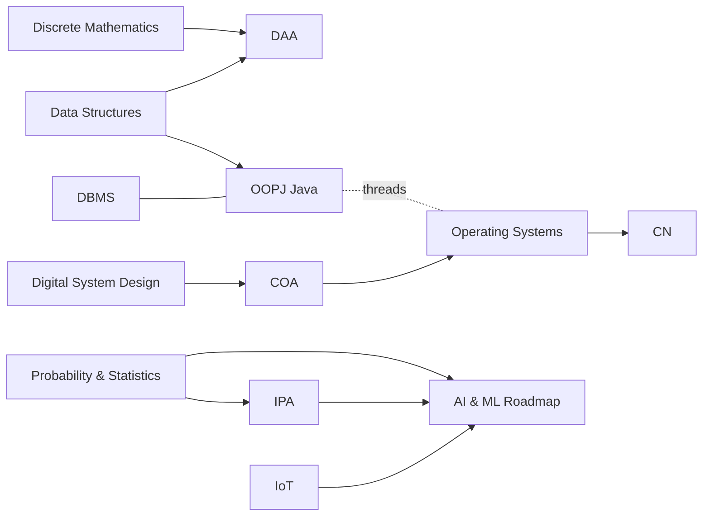

# 🎓 Academics & CS

Every course, lab and project, organised by semester. Each course page lists its notes and links to related subjects, so you can hop between OS ↔ Java threads ↔ DAA ↔ data structures.

**Up:** [[MOC]] · **Dashboard:** [[Home]] · **Stat:** [[Intel]]

## Semester 3
- Semester hub: [[Semester 3]]
- 🧱 [[Data Structures]] *(9 notes)*
- 📡 [[IoT]] *(6 notes)*
- 🎲 [[Probability & Statistics]] *(3 notes)*
- 🔌 [[Digital System Design]] *(0 notes)*

## Semester 4
- Semester hub: [[Semester 4]]
- 🖥️ [[COA]] *(4 notes)*
- ∑ [[Discrete Mathematics]] *(1 notes)*
- ☕ [[OOPJ (Java)]] *(34 notes)*
- 🐧 [[Operating Systems]] *(13 notes)*
- 🤖 [[DAWR]] *(3 notes)*
- 🗄️ [[DBMS]] *(2 notes)*
- 📝 [[Mid-Semester]] *(2 notes)*

## Semester 5
- Semester hub: [[Semester 5]]
- 🌐 [[CN]] *(1 notes)*
- ⏱️ [[DAA]] *(9 notes)*
- 🖼️ [[IPA]] *(1 notes)*
- 🏗️ [[SE]] *(0 notes)*
- 📐 [[SVP]] *(0 notes)*

## Projects & practice
- 🛠️ [[Projects]] *(7 notes)*
- 🤖 [[AI & ML Roadmap]]
- 💡 [[Good Prompts]]

## Cross-subject map

