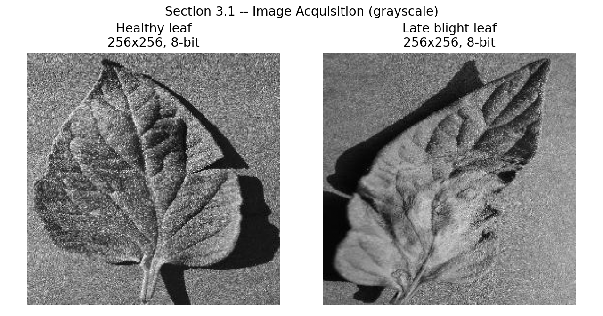
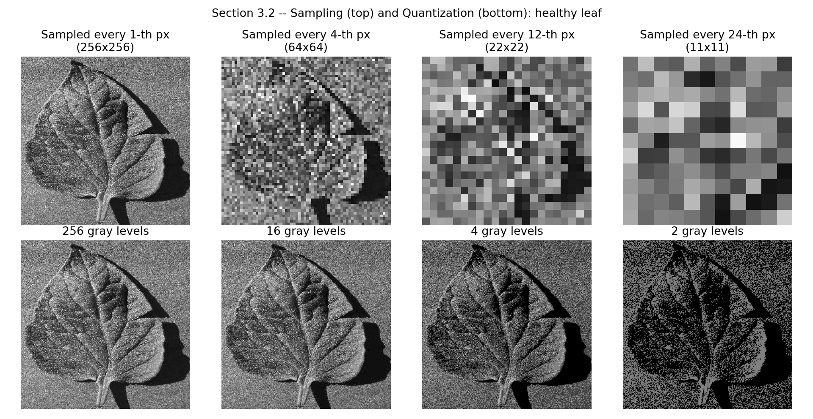
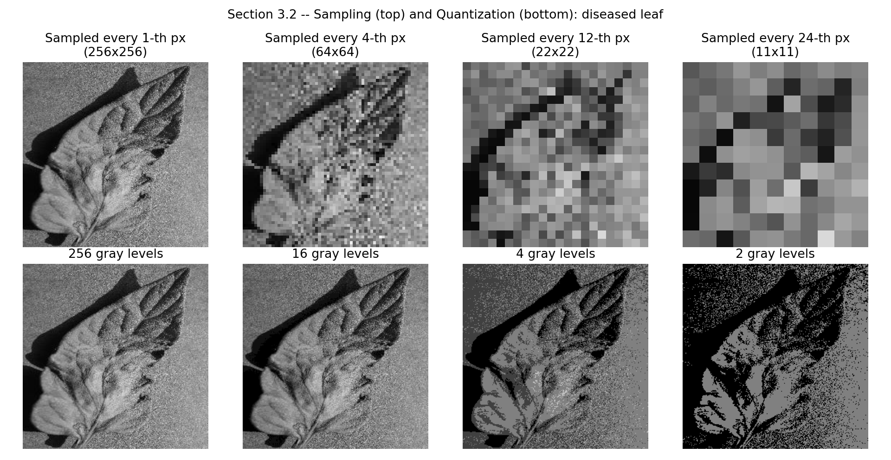
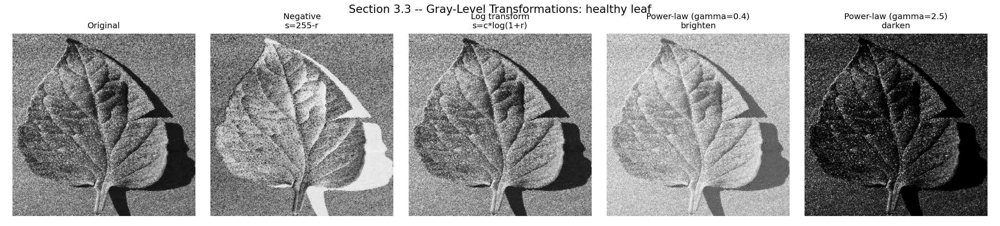
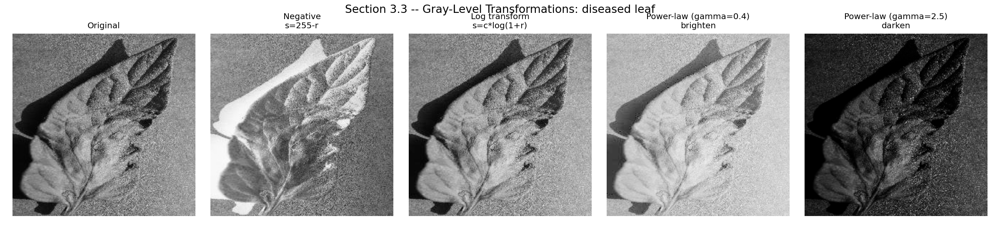
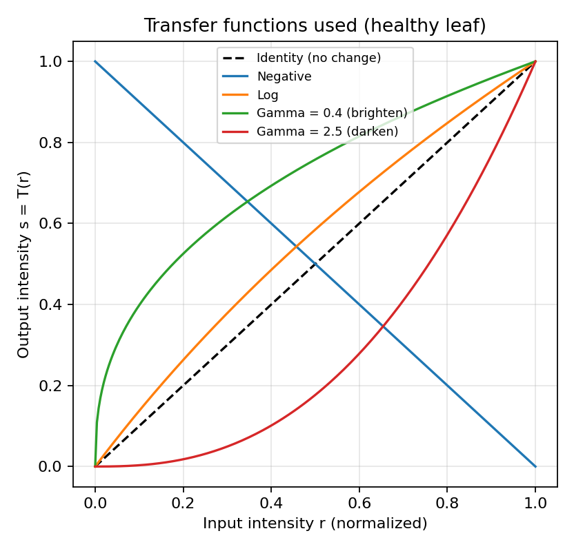
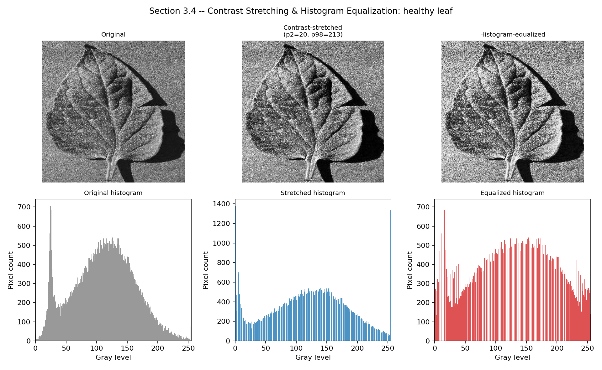
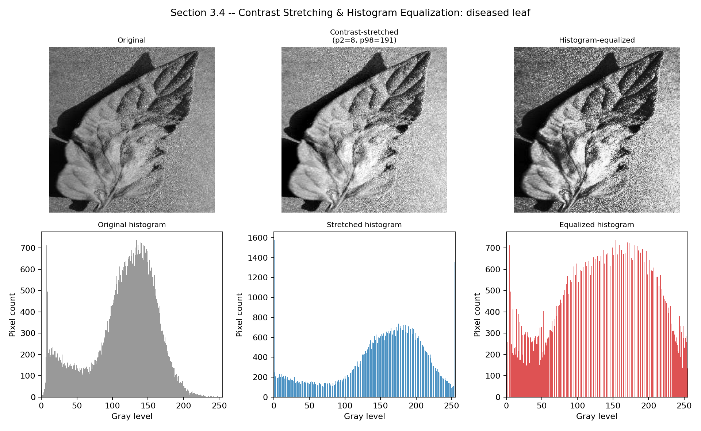
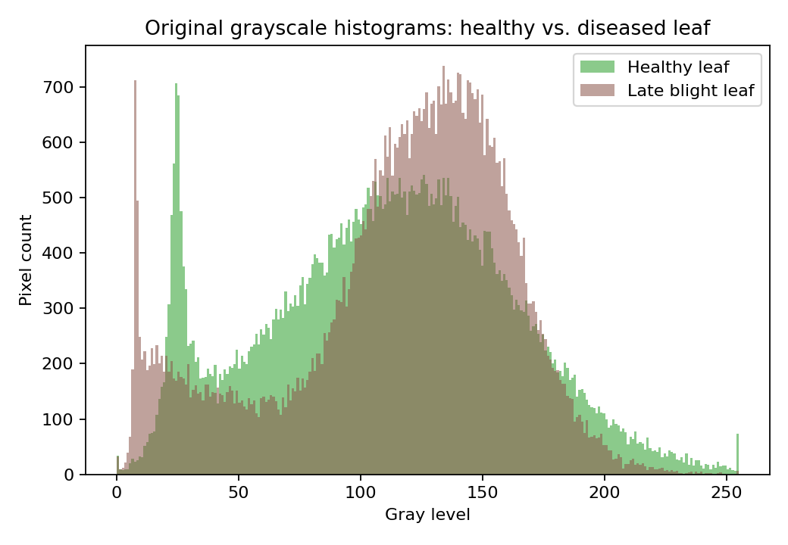

# Preliminary Digital Image Processing Analysis of Tomato Leaf Images (Healthy vs. Late Blight)

**A Course Project Report — Unit I: Introduction and Digital Image Fundamentals**

---

**Author:** Suryansh Mithu  **Course:** Image Processing and Analysis (IPA - 16)  **Date:** 18 August 2026

**Roll** : 24155060

---

## Abstract

Plant diseases such as late blight cause enormous crop losses every year, and farmers often cannot tell early on whether a leaf is genuinely sick or just dusty or sun-stressed. This report builds a small, self-contained digital image processing (DIP) pipeline, restricted to the **early, low-level stages of Unit I**, that takes a grayscale photograph of a tomato leaf and studies how its intensity structure changes under sampling, quantization, gray-level transformation, and enhancement. We use two real grayscale photographs supplied for this assignment — one **healthy** tomato leaf and one leaf infected with **late blight** — and process both, at every stage, entirely in single-channel grayscale (no colour, segmentation, or classification is used). All code is written in Python using OpenCV, NumPy, scikit-image, and Matplotlib. Within the scope of these four techniques alone, the two leaves are already distinguishable: the diseased leaf's histogram has a **narrower dynamic range** (183 gray levels between the 2nd and 98th percentile, versus 193 for the healthy leaf) and a **higher mean intensity after contrast stretching** (148.7 vs. 119.4), consistent with the visibly brighter, dried-out necrotic tissue on the diseased leaf. A firm health/disease diagnosis, however, is **beyond what these four stages alone can support** — that would require the segmentation, morphology, and description/recognition stages, which are intentionally outside the scope of this report.

---

## 1. Introduction and Problem Statement

### 1.1 Why this problem?

Tomato is one of the most widely grown vegetable crops in the world, and **late blight** (caused by the oomycete _Phytophthora infestans_) is one of its most destructive diseases — it was, famously, the cause of the Irish potato famine on the related potato crop. Late blight spreads quickly in humid weather and can destroy an entire field within days if it is not caught early. Smallholder farmers frequently do not have access to a plant pathologist and must decide, just by looking at a leaf, whether it needs treatment.

This report asks a narrower, more disciplined version of that question, matched to what has been covered so far in the course:

> **Given a grayscale photograph of a single tomato leaf, what can the fundamental, low-level image processing operations — acquisition, sampling and quantization, gray-level transformation, and histogram-based enhancement — already tell us about the difference between a healthy leaf and a diseased one?**

### 1.2 Scope of this report

This report deliberately implements **only four stages** of the classical DIP pipeline:

1. Image Acquisition
2. Sampling and Quantization
3. Gray-Level (Intensity) Transformations
4. Image Enhancement — Contrast Stretching and Histogram Equalization

Later-stage topics from Unit I and beyond — restoration, colour processing, wavelets, compression, segmentation, morphology, representation/description, and recognition — are **not** implemented here; they are left for a follow-up assignment. Every image in this report is processed as a **single-channel grayscale array**, since colour processing is out of scope.

---

## 2. Dataset

Two grayscale JPEG photographs of tomato leaves (256×256 pixels) were supplied for this assignment:

| Image file | Class | Ground truth |
|---|---|---|
| `Tomato__healthy.JPG` | Healthy | Healthy |
| `Tomato___Late_blight.JPG` | Late blight | Diseased |

These are consistent with the class structure of the public **PlantVillage dataset** (Mohanty, Hughes & Salathé, 2016), which contains the `Tomato___healthy` and `Tomato___Late_blight` classes among its 38 crop/disease categories.

Both images are shown in Figure 1 — this is the raw output of the **image acquisition** stage of the pipeline (Section 3.1), loaded directly as 8-bit grayscale.

---

## 3. Methodology — The Digital Image Processing Pipeline

Following Unit I of the course, both leaf images are passed, side by side, through the four stages below. The full, runnable source code is given in Appendix A and is also provided as a standalone file, `code/dip_pipeline.py`.

### 3.1 Image Acquisition

An image is captured when a scene is illuminated, light reflects off the leaf, and a camera's sensor focuses and samples that light into a discrete grid of pixels. Because both supplied images are already grayscale photographs, "acquisition" here means reading each JPEG file directly as a single-channel 8-bit array:

```python
import cv2

gray_healthy  = cv2.imread("images/input/Tomato__healthy.JPG",      cv2.IMREAD_GRAYSCALE)
gray_diseased = cv2.imread("images/input/Tomato___Late_blight.JPG", cv2.IMREAD_GRAYSCALE)

print(gray_healthy.shape,  gray_healthy.dtype)   # (256, 256) uint8
print(gray_diseased.shape, gray_diseased.dtype)  # (256, 256) uint8
```



_Figure 1. The two leaf photographs used throughout this report, read directly as 8-bit single-channel grayscale images — the raw output of the acquisition stage._

The image is a function `f(x, y)` of two spatial coordinates, and because both the coordinates and the intensity values are finite and discrete, it is — by definition — already a **digital image**.

### 3.2 Sampling and Quantization

The lecture defines _sampling_ as digitizing the spatial coordinates and _quantization_ as digitizing the amplitude (gray level). To make this concept visible, we artificially re-sample and re-quantize each grayscale leaf image:

```python
def subsample(img, factor):
    return img[::factor, ::factor]          # keep every k-th pixel

def requantize(img, levels):
    factor = 256 // levels
    return (img // factor) * factor          # collapse to L gray levels
```

Figures 2a and 2b show what happens as the sampling rate is reduced (top row) and the number of quantization levels is reduced (bottom row), for the healthy and diseased leaf respectively. Coarser sampling produces a blocky, pixelated image (loss of spatial resolution), while coarser quantization produces visible "banding" or false contours (loss of gray-level resolution) — exactly the two effects described in the lecture.



_Figure 2a. Healthy leaf. Top row: image sampled every 1st, 4th, 12th and 24th pixel. Bottom row: same image quantized to 256, 16, 4 and 2 gray levels._



_Figure 2b. Diseased leaf. Top row: image sampled every 1st, 4th, 12th and 24th pixel. Bottom row: same image quantized to 256, 16, 4 and 2 gray levels._

Even at only **4 gray levels**, the coarse silhouette of the leaf and the darker shadow/lesion regions remain distinguishable from the lighter tissue in both images, which is an early hint that gray-level structure alone carries some diagnostic information — a hint we push further in the next two sections.

### 3.3 Gray-Level (Intensity) Transformations

Before doing anything complicated, Unit I teaches the three classical point-wise gray-level transformation functions `s = T(r)`:

- **Negative transform:** `s = 255 - r` (useful for highlighting dark detail in bright regions, similar to a photographic negative).
- **Log transform:** `s = c · log(1 + r)` (compresses the dynamic range, brings out low-intensity detail).
- **Power-law / gamma transform:** `s = c · r^γ` (γ < 1 brightens the image, γ > 1 darkens it — this is exactly what "gamma correction" on a monitor does).

```python
gray_f = gray.astype(float) / 255.0

negative     = 255 - gray
log_img      = (np.log1p(gray_f) / np.log1p(1.0) * 255).astype("uint8")
gamma_bright = (np.power(gray_f, 0.4) * 255).astype("uint8")   # brighten
gamma_dark   = (np.power(gray_f, 2.5) * 255).astype("uint8")   # darken
```



_Figure 3a. Healthy leaf. From left to right: original, negative, log transform, and two power-law (gamma) transforms — one that brightens the leaf (γ = 0.4) and one that darkens it (γ = 2.5)._



_Figure 3b. Diseased leaf. From left to right: original, negative, log transform, and two power-law (gamma) transforms (γ = 0.4 and γ = 2.5)._




_Figure 4a/4b. The actual `s = T(r)` curves used to produce Figure 3a/3b, plotted on normalised axes. The dashed line is the identity transform (no change)._

The log transform and the brightening gamma curve (γ = 0.4) are particularly useful here because the darker, necrotic-looking part of the diseased leaf and its shadow region are quite dark; stretching the dark end of the histogram makes their internal texture visible without saturating the already-bright healthy tissue.

### 3.4 Image Enhancement (Contrast Stretching and Histogram Equalization)

Enhancement improves the _visual quality_ of the image for a human viewer or a downstream algorithm — it does not try to reconstruct a "true" image, it simply makes important details easier to see. We apply two enhancement techniques, and inspect the underlying histograms directly:

1. **Contrast stretching** — linearly re-scales intensities between the 2nd and 98th percentile of the histogram to `[0, 255]`, removing outliers without a full histogram equalization.
2. **Global histogram equalization** — flattens the cumulative histogram so that all gray levels are used equally, maximising global contrast.

```python
p2, p98   = np.percentile(gray, (2, 98))
stretched = exposure.rescale_intensity(gray, in_range=(p2, p98))

equalized = cv2.equalizeHist(gray)
```



_Figure 5a. Healthy leaf. Top row: original, contrast-stretched, and histogram-equalized image. Bottom row: the corresponding histograms — note how equalization spreads the histogram out to fill the whole [0, 255] range._



_Figure 5b. Diseased leaf. Top row: original, contrast-stretched, and histogram-equalized image. Bottom row: the corresponding histograms._



_Figure 6. Original grayscale histograms of the healthy leaf (green) and the diseased leaf (brown), overlaid on the same axes. The diseased leaf has a taller, narrower peak of very dark pixels (background shadow region) and a histogram body shifted slightly toward higher intensities compared to the healthy leaf._

Table 1 summarises the numeric statistics extracted from this stage.

**Table 1. Intensity statistics extracted from Sections 3.3–3.4.**

| Quantity | Healthy leaf | Diseased leaf |
|---|---|---|
| Mean intensity (original) | 110.95 | 115.31 |
| Std. deviation (original) | 50.52 | 47.11 |
| 2nd percentile (`p2`) | 20 | 8 |
| 98th percentile (`p98`) | 213 | 191 |
| Dynamic range (`p98 − p2`) | 193 | 183 |
| Mean after contrast stretching | 119.39 | **148.74** |
| Std. dev. after contrast stretching | 65.52 | 64.87 |
| Mean after histogram equalization | 128.17 | 128.35 |
| Std. dev. after histogram equalization | 73.66 | 73.81 |

---

## 4. Results and Discussion

Within the strict scope of these four stages, three observations stand out:

- **Dynamic range.** The healthy leaf spans a slightly wider 2nd–98th-percentile range (193 gray levels) than the diseased leaf (183 gray levels). The diseased leaf's histogram is more front-loaded with very dark pixels (`p2 = 8`, vs. `20` for the healthy leaf), consistent with the deeper background shadow visible in Figure 1 and with necrotic tissue absorbing more light than healthy tissue.
- **Post-stretch brightness shift.** After contrast stretching, the diseased leaf's mean intensity (148.7) is noticeably higher than the healthy leaf's (119.4) — a ~29-level gap that was much smaller before stretching (115.3 vs. 111.0). This is because contrast stretching remaps each image's own `[p2, p98]` window to the full `[0, 255]` range, and the diseased leaf's mid-tones (the pale, dried, blighted tissue) occupy a proportionally larger share of its histogram, so they get pushed further up the new intensity scale.
- **Histogram equalization erases the gap.** After full histogram equalization, both leaves converge to almost identical means (128.17 vs. 128.35) and standard deviations (73.66 vs. 73.81). This is expected — equalization is a global, dataset-independent normalization, so it removes exactly the kind of per-image brightness/contrast signature that made the leaves distinguishable after contrast stretching. This is a useful, concrete illustration of *why* the choice of enhancement technique matters: contrast stretching **preserves** relative differences between images, while histogram equalization **erases** them.

These findings are visual/statistical, not diagnostic. They tell us that the two leaves have measurably different intensity distributions — enough to be visible to the eye in Figures 1, 5a and 5b, and enough to shift summary statistics in Table 1 — but they do **not**, by themselves, allow us to compute a lesion percentage or issue a "healthy/mild/severe" diagnosis. That would require segmenting the necrotic region from the healthy tissue and background (a mid-level task), extracting shape/texture descriptors from it, and applying a decision rule (a high-level task) — all of which are explicitly out of scope for this report.

---

## 5. Limitations

- **Grayscale-only.** All colour information is discarded at the acquisition stage. In the full PlantVillage-style pipeline, the Hue and Saturation channels are what most cleanly separate diseased (brown/yellow) tissue from healthy (green) tissue; without colour, we are limited to whatever the *luminance* alone reveals, which is a much weaker signal.
- **No segmentation.** The leaf silhouette, the shadow, and the diseased patch are never separated from one another or from the background in this report. The histogram statistics in Table 1 are therefore whole-image statistics — background pixels and shadow pixels are mixed in with leaf-tissue pixels, which dilutes the disease-related signal.
- **Two images only.** All numeric comparisons here are drawn from a single healthy/diseased image pair. No claim can be made about statistical significance or generalization to other leaves, lighting conditions, or camera angles.
- **Why this still matters.** Despite these limitations, this report shows that even the earliest stages of the DIP pipeline — acquisition, sampling and quantization, gray-level transformation, and histogram-based enhancement — already surface a measurable, explainable difference between a healthy and a diseased leaf, using nothing but pixel-value statistics. This motivates, but does not replace, the segmentation → morphology → description → recognition stages that would be needed for an actual diagnostic tool.

---

## 6. Conclusion

This report implemented a **deliberately narrow, four-stage** digital image processing pipeline — image acquisition, sampling and quantization, gray-level transformation, and enhancement (contrast stretching and histogram equalization) — entirely in grayscale, using two real tomato leaf photographs (one healthy, one late-blight-infected). Within this limited scope, the pipeline surfaced a measurable difference between the two leaves: the diseased leaf has a narrower original dynamic range and, after contrast stretching, a markedly higher mean intensity than the healthy leaf, while global histogram equalization erases this difference by design. These are useful, explainable, low-level observations, but they fall short of a diagnosis; a reliable healthy-vs-diseased decision would require the segmentation, morphological, and description/recognition stages that are intentionally excluded from this report and left for future work.

---

## References

1. Mohanty, S. P., Hughes, D. P., & Salathé, M. (2016). _Using Deep Learning for Image-Based Plant Disease Detection._ Frontiers in Plant Science, 7, 1419. `https://arxiv.org/abs/1604.03169`
2. PlantVillage Dataset (GitHub mirror): `https://github.com/spMohanty/PlantVillage-Dataset`
3. PlantVillage Dataset (Kaggle mirror): `https://www.kaggle.com/datasets/emmarex/plantdisease`
4. Gonzalez, R. C., & Woods, R. E. _Digital Image Processing_ (4th ed.). Pearson — course textbook for Unit I concepts (image formation, sampling/quantization, gray-level transforms, enhancement).
5. OpenCV documentation: `https://docs.opencv.org`
6. scikit-image documentation: `https://scikit-image.org`

---

## Appendix A — Full Python Source Code

The complete, runnable pipeline (`code/dip_pipeline.py`) used to generate every figure and table in this report is included alongside this document. Key library versions used: `opencv-python 4.13`, `scikit-image 0.26`, `numpy 2.4`, `matplotlib 3.10`.

```python
"""
dip_pipeline.py
================
Digital Image Processing pipeline (GRAYSCALE ONLY) for tomato leaf
disease screening, restricted to four stages:

    1. Image Acquisition
    2. Sampling and Quantization
    3. Gray-Level Transformations
    4. Image Enhancement (Contrast Stretching + Histogram Equalization)

Input images :
    images/input/Tomato__healthy.JPG
    images/input/Tomato___Late_blight.JPG

Output figures (saved to images/output/) are referenced directly in the
report (report.md / report.tex).

Libraries: opencv-python, numpy, matplotlib, scikit-image
"""

import os
import cv2
import numpy as np
import matplotlib.pyplot as plt
from skimage import exposure

# ---------------------------------------------------------------------
# Paths
# ---------------------------------------------------------------------
IN_DIR = os.path.join(os.path.dirname(__file__), "..", "images", "input")
OUT_DIR = os.path.join(os.path.dirname(__file__), "..", "images", "output")
os.makedirs(OUT_DIR, exist_ok=True)

HEALTHY_PATH = os.path.join(IN_DIR, "Tomato__healthy.JPG")
DISEASED_PATH = os.path.join(IN_DIR, "Tomato___Late_blight.JPG")


# =======================================================================
# SECTION 1 — IMAGE ACQUISITION
# =======================================================================
def section1_acquisition():
    """Read both leaf images and load them directly as single-channel
    grayscale images. This is the acquisition stage: light reflected
    from the leaf is focused and sampled by the camera sensor into a
    discrete grid of pixel intensities f(x, y)."""

    gray_healthy = cv2.imread(HEALTHY_PATH, cv2.IMREAD_GRAYSCALE)
    gray_diseased = cv2.imread(DISEASED_PATH, cv2.IMREAD_GRAYSCALE)

    print("Healthy leaf  :", gray_healthy.shape, gray_healthy.dtype)
    print("Diseased leaf :", gray_diseased.shape, gray_diseased.dtype)

    fig, axes = plt.subplots(1, 2, figsize=(8, 4.2))
    for ax, img, title in zip(
        axes, [gray_healthy, gray_diseased], ["Healthy leaf", "Late blight leaf"]
    ):
        ax.imshow(img, cmap="gray", vmin=0, vmax=255)
        ax.set_title(f"{title}\n{img.shape[0]}x{img.shape[1]}, 8-bit")
        ax.axis("off")
    fig.suptitle("Section 3.1 — Image Acquisition (grayscale)")
    fig.tight_layout()
    fig.savefig(os.path.join(OUT_DIR, "01_acquisition.png"), dpi=160)
    plt.close(fig)

    return gray_healthy, gray_diseased


# =======================================================================
# SECTION 2 — SAMPLING AND QUANTIZATION
# =======================================================================
def subsample(img, factor):
    """Spatial sampling: keep every 'factor'-th pixel (reduces spatial
    resolution -> blocky / pixelated appearance)."""
    return img[::factor, ::factor]


def requantize(img, levels):
    """Amplitude quantization: collapse the 256 possible gray levels
    down to 'levels' levels (reduces gray-level resolution -> visible
    false contours / banding)."""
    factor = 256 // levels
    return (img // factor) * factor


def section2_sampling_quantization(gray_healthy, gray_diseased):
    sample_factors = [1, 4, 12, 24]
    quant_levels = [256, 16, 4, 2]

    for name, img in [("healthy", gray_healthy), ("diseased", gray_diseased)]:
        fig, axes = plt.subplots(2, 4, figsize=(12, 6.2))

        # Row 1: spatial sub-sampling
        for ax, f in zip(axes[0], sample_factors):
            sampled = subsample(img, f)
            ax.imshow(sampled, cmap="gray", vmin=0, vmax=255)
            ax.set_title(f"Sampled every {f}-th px\n({sampled.shape[0]}x{sampled.shape[1]})")
            ax.axis("off")

        # Row 2: amplitude re-quantization
        for ax, levels in zip(axes[1], quant_levels):
            requant = requantize(img, levels)
            ax.imshow(requant, cmap="gray", vmin=0, vmax=255)
            ax.set_title(f"{levels} gray levels")
            ax.axis("off")

        fig.suptitle(f"Section 3.2 — Sampling (top) and Quantization (bottom): {name} leaf")
        fig.tight_layout()
        fig.savefig(os.path.join(OUT_DIR, f"02_sampling_quantization_{name}.png"), dpi=160)
        plt.close(fig)


# =======================================================================
# SECTION 3 — GRAY-LEVEL (INTENSITY) TRANSFORMATIONS
# =======================================================================
def section3_gray_level_transforms(gray_healthy, gray_diseased):
    for name, gray in [("healthy", gray_healthy), ("diseased", gray_diseased)]:
        gray_f = gray.astype(float) / 255.0

        negative = 255 - gray
        log_img = (np.log1p(gray_f) / np.log1p(1.0) * 255).astype("uint8")
        gamma_bright = (np.power(gray_f, 0.4) * 255).astype("uint8")   # gamma < 1: brighten
        gamma_dark = (np.power(gray_f, 2.5) * 255).astype("uint8")     # gamma > 1: darken

        images = [gray, negative, log_img, gamma_bright, gamma_dark]
        titles = ["Original", "Negative\ns=255-r", "Log transform\ns=c*log(1+r)",
                  "Power-law (gamma=0.4)\nbrighten", "Power-law (gamma=2.5)\ndarken"]

        fig, axes = plt.subplots(1, 5, figsize=(15, 3.4))
        for ax, im, t in zip(axes, images, titles):
            ax.imshow(im, cmap="gray", vmin=0, vmax=255)
            ax.set_title(t, fontsize=9)
            ax.axis("off")
        fig.suptitle(f"Section 3.3 — Gray-Level Transformations: {name} leaf")
        fig.tight_layout()
        fig.savefig(os.path.join(OUT_DIR, f"03_gray_level_transforms_{name}.png"), dpi=160)
        plt.close(fig)

        # transfer function curves s = T(r)
        r = np.linspace(0, 1, 256)
        s_negative = 1 - r
        s_log = np.log1p(r) / np.log1p(1.0)
        s_gamma_b = np.power(r, 0.4)
        s_gamma_d = np.power(r, 2.5)

        fig, ax = plt.subplots(figsize=(5.2, 5))
        ax.plot(r, r, "k--", label="Identity (no change)")
        ax.plot(r, s_negative, label="Negative")
        ax.plot(r, s_log, label="Log")
        ax.plot(r, s_gamma_b, label="Gamma = 0.4 (brighten)")
        ax.plot(r, s_gamma_d, label="Gamma = 2.5 (darken)")
        ax.set_xlabel("Input intensity r (normalized)")
        ax.set_ylabel("Output intensity s = T(r)")
        ax.set_title(f"Transfer functions used ({name} leaf)")
        ax.legend(fontsize=8)
        ax.grid(alpha=0.3)
        fig.tight_layout()
        fig.savefig(os.path.join(OUT_DIR, f"03b_transform_curves_{name}.png"), dpi=160)
        plt.close(fig)


# =======================================================================
# SECTION 4 — IMAGE ENHANCEMENT: CONTRAST STRETCHING + HISTOGRAM EQ.
# =======================================================================
def section4_enhancement(gray_healthy, gray_diseased):
    stats = {}

    for name, gray in [("healthy", gray_healthy), ("diseased", gray_diseased)]:
        # 1. Contrast stretching (2nd-98th percentile -> [0,255])
        p2, p98 = np.percentile(gray, (2, 98))
        stretched = exposure.rescale_intensity(gray, in_range=(p2, p98))

        # 2. Global histogram equalization
        equalized = cv2.equalizeHist(gray)

        fig, axes = plt.subplots(2, 3, figsize=(12, 7.4))

        # top row: images
        for ax, im, t in zip(
            axes[0],
            [gray, stretched, equalized],
            ["Original", f"Contrast-stretched\n(p2={p2:.0f}, p98={p98:.0f})", "Histogram-equalized"],
        ):
            ax.imshow(im, cmap="gray", vmin=0, vmax=255)
            ax.set_title(t, fontsize=9)
            ax.axis("off")

        # bottom row: histograms
        for ax, im, t, c in zip(
            axes[1],
            [gray, stretched, equalized],
            ["Original histogram", "Stretched histogram", "Equalized histogram"],
            ["gray", "tab:blue", "tab:red"],
        ):
            ax.hist(im.ravel(), bins=256, range=(0, 255), color=c, alpha=0.8)
            ax.set_title(t, fontsize=9)
            ax.set_xlabel("Gray level")
            ax.set_ylabel("Pixel count")
            ax.set_xlim(0, 255)

        fig.suptitle(f"Section 3.4 — Contrast Stretching & Histogram Equalization: {name} leaf")
        fig.tight_layout()
        fig.savefig(os.path.join(OUT_DIR, f"04_enhancement_{name}.png"), dpi=160)
        plt.close(fig)

        stats[name] = {
            "mean": float(np.mean(gray)),
            "std": float(np.std(gray)),
            "p2": float(p2),
            "p98": float(p98),
            "dynamic_range": float(p98 - p2),
            "mean_stretched": float(np.mean(stretched)),
            "std_stretched": float(np.std(stretched)),
            "mean_equalized": float(np.mean(equalized)),
            "std_equalized": float(np.std(equalized)),
        }

    # Overlaid histogram comparison: healthy vs diseased (original grayscale)
    fig, ax = plt.subplots(figsize=(6.5, 4.5))
    ax.hist(gray_healthy.ravel(), bins=256, range=(0, 255), color="tab:green",
            alpha=0.55, label="Healthy leaf")
    ax.hist(gray_diseased.ravel(), bins=256, range=(0, 255), color="tab:brown",
            alpha=0.55, label="Late blight leaf")
    ax.set_xlabel("Gray level")
    ax.set_ylabel("Pixel count")
    ax.set_title("Original grayscale histograms: healthy vs. diseased leaf")
    ax.legend()
    fig.tight_layout()
    fig.savefig(os.path.join(OUT_DIR, "04b_histogram_comparison.png"), dpi=160)
    plt.close(fig)

    return stats


if __name__ == "__main__":
    gray_healthy, gray_diseased = section1_acquisition()
    section2_sampling_quantization(gray_healthy, gray_diseased)
    section3_gray_level_transforms(gray_healthy, gray_diseased)
    stats = section4_enhancement(gray_healthy, gray_diseased)

    print("\n--- Summary statistics (Section 3.4) ---")
    for name, s in stats.items():
        print(f"\n{name.upper()} LEAF")
        for k, v in s.items():
            print(f"  {k:18s}: {v:.2f}")

```

---

## Appendix B — Folder Structure

```
IPA-Report-Assignment1/
├── report.md                          # This report (Markdown, easy to edit)
├── report.tex                         # This report (LaTeX source)
├── code/
│   └── dip_pipeline.py                # Full pipeline: sections 1-4, grayscale only
├── images/
│   ├── input/
│   │   ├── Tomato__healthy.JPG        # Supplied healthy leaf image
│   │   └── Tomato___Late_blight.JPG   # Supplied diseased leaf image
│   └── output/
│       ├── 01_acquisition.png
│       ├── 02_sampling_quantization_healthy.png
│       ├── 02_sampling_quantization_diseased.png
│       ├── 03_gray_level_transforms_healthy.png
│       ├── 03_gray_level_transforms_diseased.png
│       ├── 03b_transform_curves_healthy.png
│       ├── 03b_transform_curves_diseased.png
│       ├── 04_enhancement_healthy.png
│       ├── 04_enhancement_diseased.png
│       └── 04b_histogram_comparison.png
```

Running `python3 code/dip_pipeline.py` from the repository root regenerates every file in `images/output/` from the two source images in `images/input/`.

---

# Appendix - C Software's Used :

1. Typora : [Typora on Windows - Typora Support](https://support.typora.io/Typora-on-Windows/)

2. Pandoc : [jgm/pandoc: Universal markup converter](https://github.com/jgm/pandoc)

3. Obsidian : [Obsidian - Sharpen your thinking](https://obsidian.md/)

<!-- connections:start -->
---
> [!abstract] 🔗 Connections
> **Up:** [[IPA]] · **Semester:** [[Semester 5]] · **Map:** [[MOC]]
> **Prev:** - · **Next:** -
> **Related:** [[Clippings Index#Digital Image Processing]] · [[Probability & Statistics]] · [[AI & ML Roadmap]]
<!-- connections:end -->
